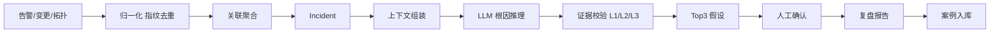

# NetScope

**把一堆告警变成一个带证据的结论。** 自动聚合告警 → 定位根因 → 给出证据链与处置建议 → 结案后沉淀为可复用案例。

> 状态：MVP-0 开发中（T06 事件工作台）。截图为验收里程碑产出，不接受占位图。

## 为什么做这个

- 一次核心设备故障会引发几十上百条衍生告警，值班人员看到的是告警风暴，不是故障本身。
- 根因判断高度依赖老员工经验，新人只能按"重启 / 换线 / 上报"三件套试错。
- 故障处置完就结束了，经验不沉淀，同类故障下次照样从零排查。

## 核心能力（MVP-0 纵向切片）

| 能力           | 说明                                                                 |
| -------------- | -------------------------------------------------------------------- |
| 告警接入       | CSV/JSON 导入 + 5 套故障剧本模拟器，按 `externalKey` 幂等            |
| 归一化与抑制   | 指纹去重、父子告警抑制、30 分钟告警周期、父告警晚到回溯              |
| 关联聚合       | 时间窗 + 拓扑 2 跳邻接 + 类型共现打分，事件边界规则 B1–B9            |
| 事件工作台     | 时间线 / 拓扑影响设备高亮 / 根因与证据面板                           |
| 根因研判       | 规则引擎候选 → LLM 结构化输出 → L1/L2/L3 证据校验（无 key 自动降级） |
| 人工确认与结案 | 状态机流转、假设采纳/否决、四段式复盘报告                            |

## 架构



分层：`app/api` → `modules`（业务规则唯一归属）→ `lib`（无业务语义）。禁止反向依赖。

## 快速开始

```bash
cp .env.example .env      # 填 DATABASE_URL；LLM key 可留空，自动降级规则引擎
npm install

# 方式 A：Docker
docker compose up -d db

# 方式 B：本地便携版 PostgreSQL（无 Docker 时）
npm run db:start

npm run db:push && npm run db:seed
npm run dev               # http://localhost:3000 → /overview

# 页面（T06 起）：/alerts 告警流 · /incidents 事件 · /incidents/[id] 三栏工作台 · /topology 只读拓扑

# 注入一套故障剧本（5 套可选；--reset 先清掉上次注入的数据）
npm run sim -- --list
npm run sim -- --scenario=core-switch-board-failure --reset

# 归一化 / 抑制状态（T04 起）
npm run alerts:stats            # ACTIVE / SUPPRESSED / RESOLVED 分布
npm run alerts:recompute        # 对存量告警重跑父告警回溯抑制（幂等）

# 关联聚合（T05 起）：把告警聚成事件，幂等可重复执行
npm run corr:run
```

健康检查：`curl -s localhost:3000/api/health | jq .`

告警列表：`curl -s "localhost:3000/api/v1/alerts?status=SUPPRESSED" | jq .`

事件列表：`curl -s "localhost:3000/api/v1/incidents?status=OPEN" | jq .`

事件详情：`curl -s "localhost:3000/api/v1/incidents/INC-20261119-001" | jq '{code, timeline: .timelineTotal}'`

拓扑：`curl -s "localhost:3000/api/v1/topology" | jq '.stats'`

手动触发聚合：`curl -s -X POST localhost:3000/api/v1/correlation/run | jq .`

## 工程门禁

```bash
npm run lint && npm run typecheck && npm run test && npm run build
```

CI 与本地一致，全部通过才允许合并。

## 文档

| 文件                        | 作用                                                    |
| --------------------------- | ------------------------------------------------------- |
| `docs/PROJECT-FRAMEWORK.md` | 唯一事实源（架构 / 数据模型 / API / 任务卡 / 验收标准） |
| `docs/AGENT-TASKS.md`       | T01–T09 任务卡与验收要点                                |
| `docs/STATE.md`             | 当前进度、偏差、阻塞                                    |
| `AGENTS.md`                 | Agent 行为契约                                          |

## Roadmap

- v0.1 MVP-0：纵向切片闭环（9 张任务卡）
- P1：拓扑编辑、SSE 流式研判、案例相似推荐（先看评测数据再决定砍哪些）
- v0.5：抽出 Python Worker（告警规则引擎 / 时序分析）

## License

MIT
