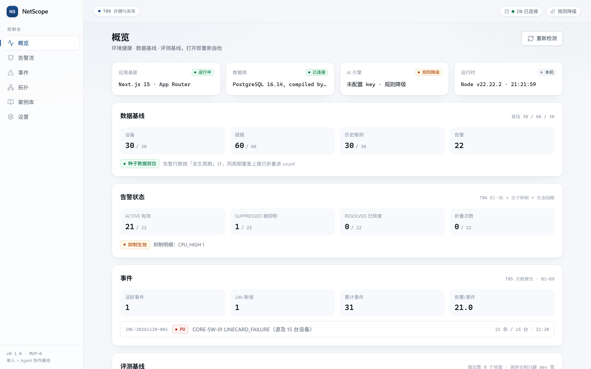
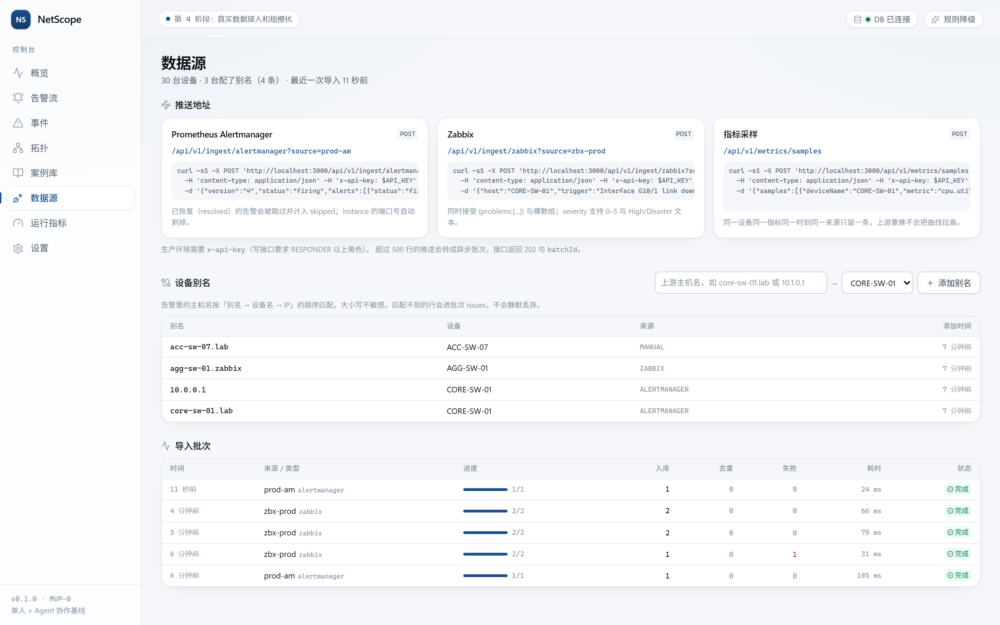
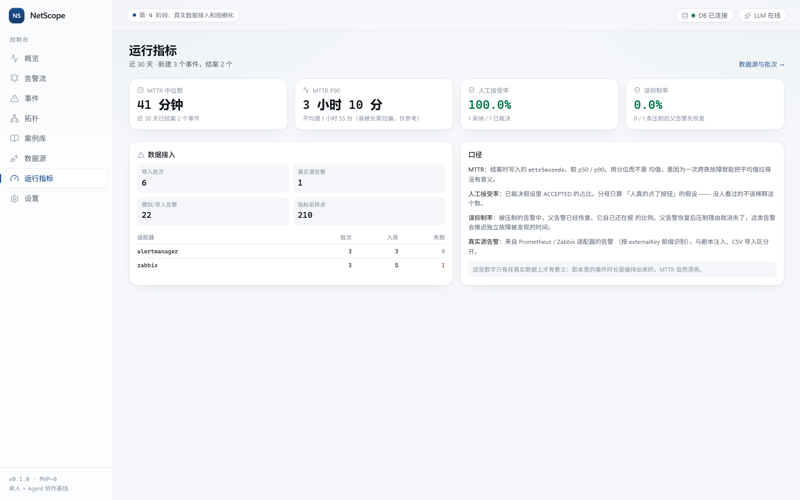
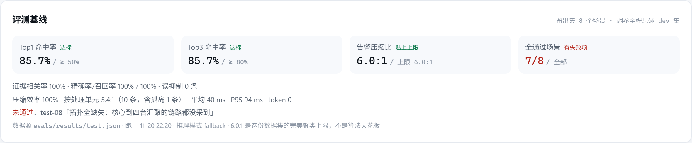

# NetScope

**把一堆告警变成一个带证据的结论。**

自动聚合告警 → 定位根因 → 给出证据链与处置建议 → 结案后沉淀为可复用案例。

> MVP-0 已完成（T01–T09）。评测分数如实写在下面，不好看的也照写。


<sub>事件详情：左侧告警时间线，中间拓扑影响面与关联告警，右侧根因研判与证据链。截图为生产构建实拍。</sub>

## 为什么做这个

- **一次核心故障会引发几十上百条衍生告警。** 值班人员看到的是一屏告警风暴，不是那个故障本身。定位故障的第一步不该是读 200 条告警。
- **根因判断依赖老员工经验。** 新人只能按"重启 / 换线 / 上报"三件套试错，试错成本直接落在业务可用性上。
- **处置完就结束了，经验不沉淀。** 同类故障下次照样从零排查，同一个坑踩第三遍。

NetScope 把这三件事串成一条链：告警先被压成事件，事件被推出带证据的假设，人确认后结案，结案自动生成复盘报告并入库成案例。

## 核心能力

| 能力           | 说明                                                                                                                                                            |
| -------------- | --------------------------------------------------------------------------------------------------------------------------------------------------------------- |
| 告警接入       | CSV/JSON 导入 + 5 套故障剧本模拟器，按 `externalKey` 幂等，重复投递不产生脏数据                                                                                 |
| 真实数据源     | Prometheus Alertmanager 与 Zabbix webhook 适配器，主机名/IP 经「设备别名」映射到 CMDB 设备；超 500 行自动转异步批次并暴露进度                                   |
| 归一化与抑制   | 指纹去重、父子告警抑制、30 分钟告警周期、父告警晚到回溯                                                                                                         |
| 关联聚合       | 时间窗 + 拓扑 2 跳邻接 + 类型共现打分，事件边界规则 B1–B9，并查集聚类；同指纹跨周期重报做二次收敛，一场未恢复的故障不会变成多张工单                             |
| 拓扑完整度     | 事件详情标注「完整 / 部分缺失 / 完全缺失」；缺拓扑时结论降级为候选排序，置信度按完整度设上限                                                                    |
| 指标快照       | 设备+指标+时间采样入库（幂等），事件窗口内算出首末值/峰谷/斜率，作为 `METRIC` 证据进入研判；没有采样时不谈趋势                                                  |
| 事件工作台     | 时间线 / 拓扑影响面高亮 / 根因与证据面板三栏联动                                                                                                                |
| 根因研判       | 规则引擎候选 → LLM 结构化输出 → L1/L2/L3 证据校验，无 key 自动降级规则引擎                                                                                      |
| 人工确认与结案 | 状态机流转（含拦截非法跳转）、假设采纳/否决、四段式复盘报告、案例入库；聚合判错时可勾选告警拆成新事件，拆分后两侧不再被自动合并                                 |
| 值班协作       | 接手 / 转派 / 释放，负责人与团队落库；按严重级定响应时限（P0 10 分钟），超时与即将超时在看板上直接标红；阶段进度条显示待接手→分析中→待确认→已定位→缓解中→已恢复 |
| 验证与影响面   | 每条假设的验证步骤可勾选，记录验证人、时间与结果备注；事件影响面同时给出「波及哪几个业务服务」和设备清单                                                        |
| 案例可信度     | 结案时有人工采纳才标 `VERIFIED`，只有已验证案例进入下次研判召回                                                                                                 |
| 运行指标       | MTTR p50/p90、人工接受率、误抑制率按窗口统计，每个数字都写清分母与口径                                                                                          |
| 安全与审计     | 多 Key RBAC（VIEWER/RESPONDER/ADMIN）、租户隔离、审计条件检索与游标分页、数据保留策略（dry-run 默认）                                                           |

### 看板：先看该谁动手，再看工程指标

首屏回答四个问题：有没有 P0/P1、哪些没人接手、哪些有结论等人拍板、哪些快到响应时限。
三个队列（无人接手 / 未研判 / 待确认）直接给可点的入口，而不是让人自己去列表里翻。



数据基线、评测基线、T02–T09 交付进度已移到「设置 → 系统状态」：值班的人每天不需要看 30 台设备有几条链路，验收的人需要时能在固定位置找到。

### 数据源：先能接进来，再谈准不准

三个推送地址（Alertmanager / Zabbix / 指标采样）配好就能收真实告警。设备名对不上是最常见的
卡点，所以「设备别名」把上游主机名、IP 直接绑到 CMDB 设备上；匹配不到的行走批次 issues，
不会静默丢弃。超过 500 行的推送转成异步批次，进度、入库、去重、失败数都能在页面上看。



### 运行指标：每个数字都有分母

MTTR 用 p50/p90 而不是平均值（一次跨夜故障就能把均值变成谣言）；接受率的分母只算「人真的
点了按钮」的假设；误抑制率按「父告警已恢复而它还在报」计算 —— 父告警恢复后压制理由就消失了，
这类告警会推迟独立故障被发现的时间。



### 拓扑：只读分层视图，活跃告警设备标红


### 案例库：结案自动沉淀，可按现象/根因/标签检索


卡片上的「已验证 / 待确认」是召回资格，不是装饰：结案时有人工采纳的假设才标为已验证，只有已验证的案例会进入下一次研判的上下文 —— 未经确认的机器猜测留在库里可查，但不会被当成历史经验引用。

界面统一走 `src/app/globals.css` 的 `@theme` 令牌：冷中性灰底、分层阴影、细描边，组件内不写死色值。卡片、状态徽标、分段筛选器、按钮分别收敛为 `ui/card.tsx`、`ui/status-pill.tsx`、`ui/tabs.tsx`、`ui/button.tsx`，改一处配色即全局生效。以上截图由 `node scripts/screenshots.mjs` 注入剧本后真实渲染生成，不是手摆的示意图。

## 架构


分层：`app/api` → `modules`（业务规则唯一归属）→ `lib`（无业务语义）。禁止反向依赖。

17 张表：`Device` / `DeviceAlias` / `TopologyLink` / `AlertFingerprint` / `Alert` / `Incident` / `ChangeRecord` / `CaseRecord` / `Hypothesis` / `HypothesisVerify` / `Service` / `ServiceDevice` / `MetricSample` / `IngestBatch` / `Tenant` / `Report` / `AuditLog`。

## 快速开始

### 方式 A：Docker（一条命令）

```bash
cp .env.example .env
docker compose up --build          # 起 Postgres + 应用，首次启动自动建表并播种
open http://localhost:3000
```

容器启动序列：`prisma db push` 建表 → `scripts/seed.ts` 播种（30 设备 / 60 链路 / 30 案例，幂等）→ `next start`。
`.env` 里的 `DATABASE_URL` 指向 `localhost`，compose 会覆盖成服务名 `db`，无需手改。

> ⚠️ 本机未安装 Docker，Dockerfile 与 compose 已按容器内路径逐行校对（含 `DATABASE_URL` 覆盖、非 root 用户、healthcheck），但**未做实际构建验证**。本地路径已验证到 `npm run build && npm run start`。

### 方式 B：本地（无 Docker）

```bash
cp .env.example .env       # LLM key 可留空，研判自动降级规则引擎
npm install
npm run db:start           # 便携版 PostgreSQL 16
npm run db:push && npm run db:seed
npm run dev                # http://localhost:3000
```

注入一套故障剧本看看（5 套可选）：

```bash
npm run sim -- --list
npm run sim -- --scenario=core-switch-board-failure --reset
```

## AI 研判是怎么工作的

四个阶段，每一阶段都可以被单独质疑：

1. **候选生成**：规则引擎先按「拓扑邻接 + 同类型共现 + 自身告警」打分，不做黑盒推理，只缩小范围。
2. **结构化推理**：LLM 拿到拓扑 2 跳、近 24h 变更、历史相似案例，输出固定 schema 的 Top3 假设（结论文本 + 置信度 + 证据列表 + 验证步骤）。
3. **证据校验（L1/L2/L3）**——这是整个系统最要紧的一段，因为 LLM 最常见的失败不是结论错，而是**编造证据**：
   - **L1 存在性**：证据引用的告警 / 设备 / 变更在库里查不到，整条假设丢弃；
   - **L2 相关性**：证据存在但与事件无关（别的设备、别的时间窗），只剔掉这条证据；
   - **L3 一致性**：结论与证据方向相反（证据说链路正常，结论说链路断了），保留结论但下调置信度。
4. **人工裁决**：任何一条假设都必须由人点「采纳」，报告中未采纳的结论会明确标注为「AI 推断，未经人工确认」。

没有 key 时全链路降级到规则引擎（`source=RULE_FALLBACK`），功能完整、结论可解释，只是推理深度下降。上表所有分数都是在**降级模式**下跑出来的——这是下限，不是上限。

### 评测（留出集，未参与调参）

```bash
npm run eval -- --set=test      # 8 个留出场景
npm run eval -- --set=dev       # 17 个开发场景
```

25 个场景分三类：正例（正常故障链）、干扰例（有误导性变更 / 假阳性告警）、对抗例（缺拓扑、未知采集项、跨周期重挂、超时间窗重报）。dev 与 test 分离，调参只碰 dev；留出集在算法改动后重跑过一次，结果照记。

| 指标                    | test 集         | 目标          | dev 集        |
| ----------------------- | --------------- | ------------- | ------------- |
| Top1 命中率             | **85.7%** (6/7) | ≥ 50%         | 86.7% (13/15) |
| Top3 命中率             | **85.7%** (6/7) | ≥ 80%         | 93.3% (14/15) |
| 证据相关率（L2 后）     | **100%**        | 基线          | 100%          |
| 事件精确率 / 召回率     | **100% / 100%** | ≥ 85% / ≥ 90% | 100% / 100%   |
| 根因告警误抑制率        | **0%**          | = 0           | 0%            |
| 平均 / P95 研判耗时     | **40 / 94 ms**  | < 8 s         | 28 / 98 ms    |
| 告警压缩比（整体）      | **6.0:1**       | 上限 6.0:1 ✅ | 8.3:1         |
| 压缩比理论上限          | 6.0:1           | —             | 8.3:1         |
| 压缩效率（实际 / 理论） | **100%**        | ≥ 95%         | 100%          |
| 压缩比（按处理单元）    | 5.4:1           | ≥ 8:1 ⚠️      | 6.6:1         |
| 全通过场景              | 7/8             | —             | 16/17         |

> ⚠️ 是"目标在这份数据集上不可达"，不是"没做到"：8:1 需要平均每个事件 ≥ 8 条告警，而 test 集是 54 条告警 / 9 个事件。压缩质量以效率（实际 / 理论上限）判定，100% 即已贴住上限。

这张卡片是设置页真实的渲染结果，读数直接来自 `evals/results/test.json` —— 不是手写的图：



**没做到的地方，照实说：**

- 表头两个耗时是同一台机器上的单次实测，会随机器负载在 ±10 ms 内浮动 —— 它的意义是"毫秒级、不是秒级"，不是精确基准。
- **6.0:1 不是聚类没做好，是数据集的上限**：test 集 54 条告警、标注 9 个事件，完美聚类的理论上限就是 6.0:1。压缩效率 100% 说明当前结果已经贴住上限；"≥ 8:1" 这个目标只有在平均每个事件 ≥ 8 条告警的真实数据上才有意义。分组看差异更清楚：正例 7.5:1、干扰例 7.5:1、对抗例 4.8:1，对抗例本身只有 3–4 条告警，结构上不可能到 8。
- **按处理单元只有 5.4:1**：9 个事件 + 1 条没归入任何事件的孤岛告警。这条口径是新增的，用来暴露"事件数漂亮但仍有告警需要人工逐条看"的情况，比只报事件压缩比更接近值班人的负担。
- **Top1/Top3 的分母是 7 不是 8**：test-07 是"未知采集项"，标注期望是「给不出结论」，不计入命中率分母。把它算进分母会让数字更好看，但那是在自欺。
- **唯一失败场景 test-08**：核心到四台汇聚的链路**全部**没采到。详情页现在会标「拓扑部分缺失」并把结论降级为候选排序、下压置信度 —— 把能力边界显示出来，比假装没有更有用。
- 分类不均衡：dev 是 6 正例 / 5 干扰 / 6 对抗，test 是 2/2/4，与框架设想的 8/8/8 不一致。对抗例偏多是刻意的——MVP 阶段错判的代价比漏判高。

## 工程门禁

```bash
npm run lint && npm run typecheck && npm run test && npm run build
```

316 个单测（41 文件），含数据库集成用例；CI 与本地一致，全绿才允许合并。

两条 Playwright E2E 覆盖主路径：

```bash
npx playwright test       # ① 看板→详情→接手→研判→采纳→结案  ② 剧本注入→事件→报告下载
```

截图由 `node scripts/screenshots.mjs` 生成，注入剧本后真实渲染，不是手摆的图。

### 第 4 阶段验收（一条命令）

```bash
npm run accept:phase4                 # 只读：健康检查 / 页面 / 批次 / 保留 dry-run / 别名解析
npm run accept:phase4 -- --write      # 追加写入：Alertmanager + Zabbix + 指标采样，验完整链路
npm run accept:phase4 -- --clean      # 清掉刚才写入的验收数据
```

输出是逐项 `[PASS] / [FAIL] / [SKIP]` 加实测值（如「跳过已恢复=1 失败=0 入库=1」），
退出码非 0 表示有失败。默认只读，因为同一份脚本会被对着生产实例跑一次；写入的数据都带
`acceptance` 标记，`--clean` 可清干净（审计日志保留，它是追加型证据链）。

脚本验不了的三件事单列在结尾，不混进 PASS：真实环境 ≥1 万条回填、降级模式下接受率是否可信、
误抑制是「压错对象」还是「压太久」——当前口径只覆盖前者。

### 回填压测（1.2 万条，独立临时库）

```bash
npm run loadtest:ingest -- --base=http://127.0.0.1:3200 --total=12000   # 灌 + 计时
npm run loadtest:ingest -- --clean                                      # 按 externalKey 前缀清场
```

按接口的真实约束分 3 批（JSON 单请求上限 5000 条 / 请求体 2 MB），本机单实例实测：

| 指标               | 实测                                       |
| ------------------ | ------------------------------------------ |
| 回填量             | 12 000 条 / 3 批（每批 4000 行 ≈ 1059 KB） |
| 墙钟 / 吞吐        | 36.2s · 331 行/秒（单批 11.2–12.2s）       |
| 202 受理           | p50 60ms · p90 123ms（异步，不阻塞请求）   |
| 入库 / 去重 / 失败 | 9008 / 2399 / 593                          |
| 去重率             | 20.0%（= 构造的重报率）                    |
| 设备不存在         | 4.9%（= 故意写错的 593 条，差 0）          |

三个读这张表时容易误会的点：**抑制 6851 条（76%）是数据构成造成的**（9 类告警里含父告警
`DEVICE_UNREACHABLE`，每台设备都有）；**回填不产生事件**（聚合只吃近 30 分钟仍活跃的告警，
24 小时历史里周期已过期，9000 条入库后只出 48 条候选 / 2 个簇）；**瓶颈是逐行往返**，
调 `INGEST_CHUNK_SIZE` 不会更快。详见 `docs/STATE.md` 的已知偏差。

## 技术栈

Next.js 15 App Router（RSC）· TypeScript strict（`noUncheckedIndexedAccess`）· Prisma 6 + PostgreSQL 16 · Tailwind v4 · @xyflow/react · OpenAI 兼容协议（DeepSeek / 通义 / OpenAI）· Vitest · Playwright

不引状态管理框架、不引 UI 组件库：`app/api` 之下全是可单测的纯函数。

## Roadmap

- **v0.1 MVP-0**：纵向切片闭环（T01–T09）✅
- **第 3 阶段**：值班效率 —— 接手/SLA、队列看板、验证勾选、业务影响面、研判阶段进度 ✅
- **第 4 阶段**：真实接入与规模化 —— Alertmanager/Zabbix 适配器、异步批次、指标快照、RBAC/租户/保留策略、运行指标 ✅
- **P1**：SSE 流式研判、拓扑编辑、案例相似推荐；多租户目前是「Key 绑定租户 + 查询过滤」，设备名仍全局唯一，真正隔离需要改 `(tenantId, name)` 唯一键与指纹签名
- **v0.5**：抽出 Python Worker（告警规则引擎 / 时序异常检测），指标改接 Prometheus 长期存储

## 文档

| 文件                        | 作用                                                    |
| --------------------------- | ------------------------------------------------------- |
| `docs/PROJECT-FRAMEWORK.md` | 唯一事实源（架构 / 数据模型 / API / 任务卡 / 验收标准） |
| `docs/AGENT-TASKS.md`       | T01–T16 任务卡与验收要点                                |
| `docs/STATE.md`             | 当前进度、偏差、阻塞                                    |
| `docs/API.md`               | 接口契约                                                |
| `docs/RELEASE-v0.1.0.md`    | 本次发布的说明、升级须知、已知限制                      |
| `AGENTS.md`                 | Agent 行为契约                                          |

## License

MIT
