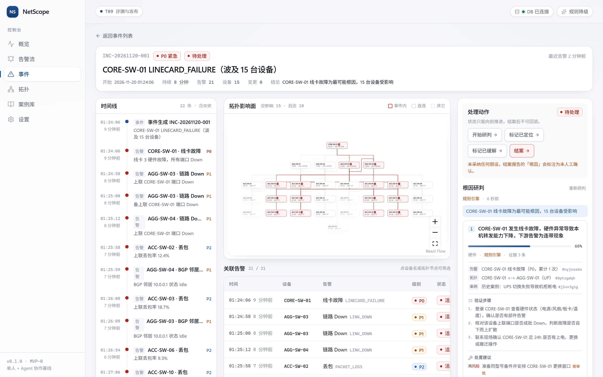
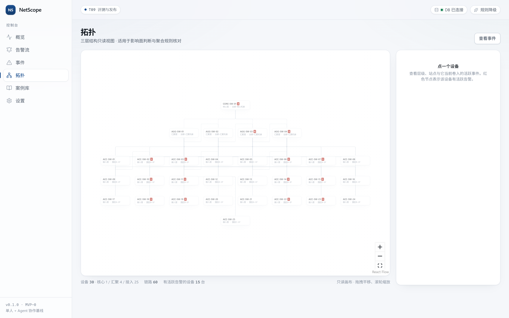
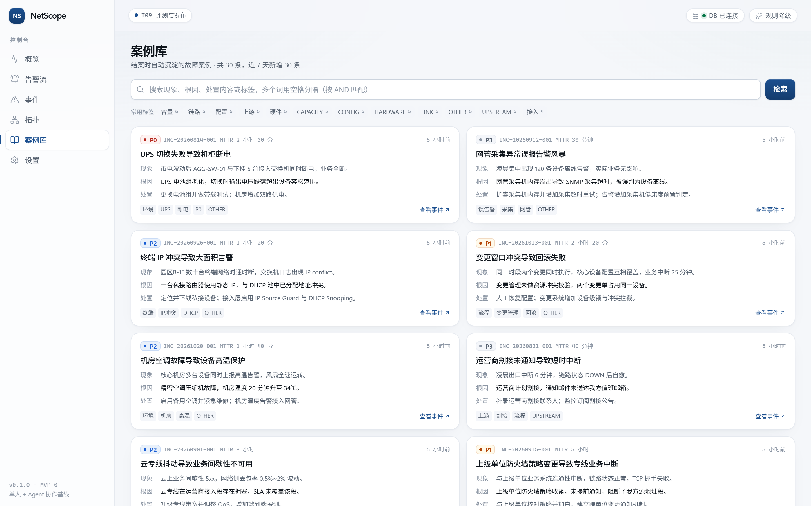
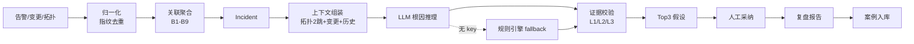

# NetScope

**把一堆告警变成一个带证据的结论。**

自动聚合告警 → 定位根因 → 给出证据链与处置建议 → 结案后沉淀为可复用案例。

> MVP-0 已完成（T01–T09）。评测分数如实写在下面，不好看的也照写。



<sub>事件详情：左侧告警时间线，中间拓扑影响面与关联告警，右侧根因研判与证据链。截图为生产构建实拍。</sub>

## 为什么做这个

- **一次核心故障会引发几十上百条衍生告警。** 值班人员看到的是一屏告警风暴，不是那个故障本身。定位故障的第一步不该是读 200 条告警。
- **根因判断依赖老员工经验。** 新人只能按"重启 / 换线 / 上报"三件套试错，试错成本直接落在业务可用性上。
- **处置完就结束了，经验不沉淀。** 同类故障下次照样从零排查，同一个坑踩第三遍。

NetScope 把这三件事串成一条链：告警先被压成事件，事件被推出带证据的假设，人确认后结案，结案自动生成复盘报告并入库成案例。

## 核心能力

| 能力           | 说明                                                                            |
| -------------- | ------------------------------------------------------------------------------- |
| 告警接入       | CSV/JSON 导入 + 5 套故障剧本模拟器，按 `externalKey` 幂等，重复投递不产生脏数据 |
| 归一化与抑制   | 指纹去重、父子告警抑制、30 分钟告警周期、父告警晚到回溯                         |
| 关联聚合       | 时间窗 + 拓扑 2 跳邻接 + 类型共现打分，事件边界规则 B1–B9，并查集聚类           |
| 事件工作台     | 时间线 / 拓扑影响面高亮 / 根因与证据面板三栏联动                                |
| 根因研判       | 规则引擎候选 → LLM 结构化输出 → L1/L2/L3 证据校验，无 key 自动降级规则引擎      |
| 人工确认与结案 | 状态机流转（含拦截非法跳转）、假设采纳/否决、四段式复盘报告、案例入库           |

### 概览：健康自检与数据基线


### 拓扑：只读分层视图，活跃告警设备标红



### 案例库：结案自动沉淀，可按现象/根因/标签检索



界面统一走 `src/app/globals.css` 的 `@theme` 令牌：冷中性灰底、分层阴影、细描边，组件内不写死色值。卡片、状态徽标、分段筛选器、按钮分别收敛为 `ui/card.tsx`、`ui/status-pill.tsx`、`ui/tabs.tsx`、`ui/button.tsx`，改一处配色即全局生效。以上截图由 `node scripts/screenshots.mjs` 注入剧本后真实渲染生成，不是手摆的示意图。

## 架构



分层：`app/api` → `modules`（业务规则唯一归属）→ `lib`（无业务语义）。禁止反向依赖。

10 张表：`Device` / `TopologyLink` / `AlertFingerprint` / `Alert` / `Incident` / `ChangeRecord` / `CaseRecord` / `Hypothesis` / `Report`。

## 快速开始

### 方式 A：Docker（一条命令）

```bash
cp .env.example .env
docker compose up --build          # 起 Postgres + 应用，首次启动自动建表并播种
open http://localhost:3000
```

容器启动序列：`prisma db push` 建表 → `scripts/seed.ts` 播种（30 设备 / 60 链路 / 30 案例，幂等）→ `next start`。
`.env` 里的 `DATABASE_URL` 指向 `localhost`，compose 会覆盖成服务名 `db`，无需手改。

> ⚠️ 本机未安装 Docker，Dockerfile 与 compose 已按容器内路径逐行校对（含 `DATABASE_URL` 覆盖、非 root 用户、healthcheck），但**未做实际构建验证**。本地路径已验证到 `npm run build && npm run start`。

### 方式 B：本地（无 Docker）

```bash
cp .env.example .env       # LLM key 可留空，研判自动降级规则引擎
npm install
npm run db:start           # 便携版 PostgreSQL 16
npm run db:push && npm run db:seed
npm run dev                # http://localhost:3000
```

注入一套故障剧本看看（5 套可选）：

```bash
npm run sim -- --list
npm run sim -- --scenario=core-switch-board-failure --reset
```

## AI 研判是怎么工作的

四个阶段，每一阶段都可以被单独质疑：

1. **候选生成**：规则引擎先按「拓扑邻接 + 同类型共现 + 自身告警」打分，不做黑盒推理，只缩小范围。
2. **结构化推理**：LLM 拿到拓扑 2 跳、近 24h 变更、历史相似案例，输出固定 schema 的 Top3 假设（结论文本 + 置信度 + 证据列表 + 验证步骤）。
3. **证据校验（L1/L2/L3）**——这是整个系统最要紧的一段，因为 LLM 最常见的失败不是结论错，而是**编造证据**：
   - **L1 存在性**：证据引用的告警 / 设备 / 变更在库里查不到，整条假设丢弃；
   - **L2 相关性**：证据存在但与事件无关（别的设备、别的时间窗），只剔掉这条证据；
   - **L3 一致性**：结论与证据方向相反（证据说链路正常，结论说链路断了），保留结论但下调置信度。
4. **人工裁决**：任何一条假设都必须由人点「采纳」，报告中未采纳的结论会明确标注为「AI 推断，未经人工确认」。

没有 key 时全链路降级到规则引擎（`source=RULE_FALLBACK`），功能完整、结论可解释，只是推理深度下降。上表所有分数都是在**降级模式**下跑出来的——这是下限，不是上限。

### 评测（留出集，未参与调参）

```bash
npm run eval -- --set=test      # 8 个留出场景
npm run eval -- --set=dev       # 16 个开发场景
```

24 个场景分三类：正例（正常故障链）、干扰例（有误导性变更 / 假阳性告警）、对抗例（缺拓扑、未知采集项、超时间窗重报）。dev 与 test 分离，调参只碰 dev。

| 指标                | test 集         | 目标          | dev 集        |
| ------------------- | --------------- | ------------- | ------------- |
| Top1 命中率         | **85.7%** (6/7) | ≥ 50%         | 85.7% (12/14) |
| Top3 命中率         | **85.7%** (6/7) | ≥ 80%         | 92.9% (13/14) |
| 证据相关率（L2 后） | **100%**        | 基线          | 100%          |
| 事件精确率 / 召回率 | **100% / 100%** | ≥ 85% / ≥ 90% | 100% / 100%   |
| 根因告警误抑制率    | **0%**          | = 0           | 0%            |
| 平均研判耗时        | **23 ms**       | < 8 s         | 21 ms         |
| 告警压缩比          | **6.0:1** ❌    | ≥ 8:1         | 8.4:1         |
| 全通过场景          | 7/8             | —             | 15/16         |

这张卡片是概览页真实的渲染结果，读数直接来自 `evals/results/test.json` —— 不是手写的图：


**没做到的地方，照实说：**

- 表头两个耗时是同一台机器上的单次实测，会随机器负载在 ±10 ms 内浮动 —— 它的意义是"毫秒级、不是秒级"，不是精确基准。
- **告警压缩比不达标**（6.0:1，目标 8:1）。test 集里 4 个对抗例本身告警就少（3–8 条），一压就稀释了比值。只算正例是 7.5:1，仍然差一点才到 8。真正的瓶颈是跨时间窗的重复告警没有二次收敛，属于 T05 边界规则的已知欠账，不是调阈值能解决的。
- **Top1/Top3 的分母是 7 不是 8**：test-07 是"未知采集项"，标注期望是「给不出结论」，不计入命中率分母。把它算进分母会让数字更好看，但那是在自欺。
- **唯一失败场景 test-08**：核心到四台汇聚的链路**全部**没采到。此时拓扑上核心是孤岛，聚合退化成按设备归并，事件覆盖不到标注设备。这是"完全无拓扑"时的能力上限，量化出来比假装没有更有用。
- 分类不均衡：dev 是 6 正例 / 5 干扰 / 5 对抗，test 是 2/2/4，与框架设想的 8/8/8 不一致。对抗例偏多是刻意的——MVP 阶段错判的代价比漏判高。

## 工程门禁

```bash
npm run lint && npm run typecheck && npm run test && npm run build
```

191 个单测（24 文件），CI 与本地一致，全绿才允许合并。

两条 Playwright E2E 覆盖主路径：

```bash
npx playwright test       # ① 概览→详情→研判→采纳→结案  ② 剧本注入→事件→报告下载
```

截图由 `node scripts/screenshots.mjs` 生成，注入剧本后真实渲染，不是手摆的图。

## 技术栈

Next.js 15 App Router（RSC）· TypeScript strict（`noUncheckedIndexedAccess`）· Prisma 6 + PostgreSQL 16 · Tailwind v4 · @xyflow/react · OpenAI 兼容协议（DeepSeek / 通义 / OpenAI）· Vitest · Playwright

不引状态管理框架、不引 UI 组件库：`app/api` 之下全是可单测的纯函数。

## Roadmap

- **v0.1 MVP-0**：纵向切片闭环（T01–T09）✅
- **P1**：拓扑编辑、SSE 流式研判、案例相似推荐（按评测结论取舍，先补压缩比欠账）
- **v0.5**：抽出 Python Worker（告警规则引擎 / 时序异常检测）

## 文档

| 文件                        | 作用                                                    |
| --------------------------- | ------------------------------------------------------- |
| `docs/PROJECT-FRAMEWORK.md` | 唯一事实源（架构 / 数据模型 / API / 任务卡 / 验收标准） |
| `docs/AGENT-TASKS.md`       | T01–T09 任务卡与验收要点                                |
| `docs/STATE.md`             | 当前进度、偏差、阻塞                                    |
| `docs/API.md`               | 接口契约                                                |
| `AGENTS.md`                 | Agent 行为契约                                          |

## License

MIT
